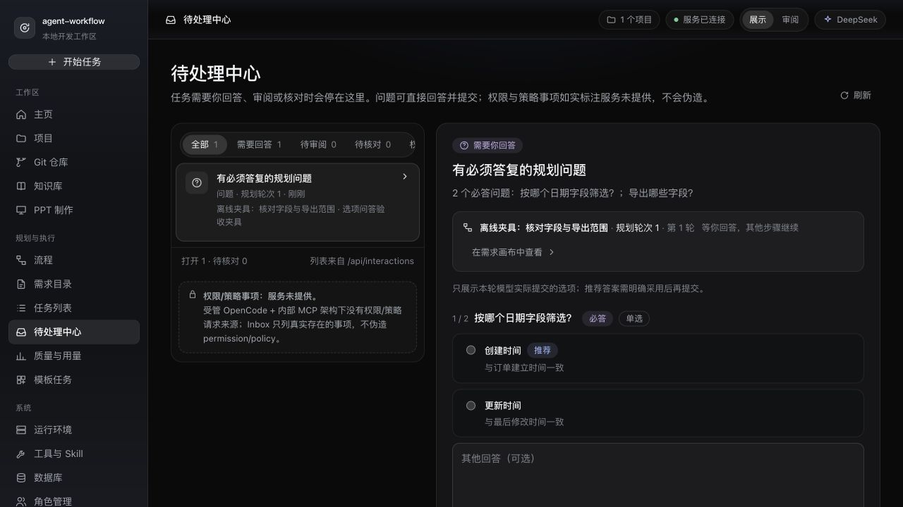
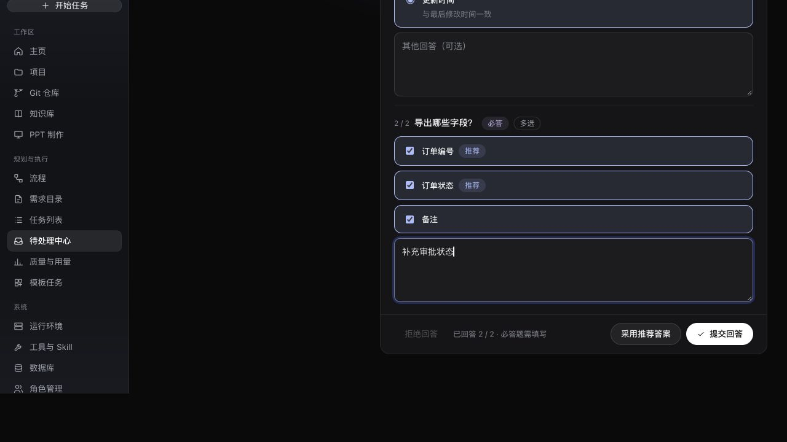
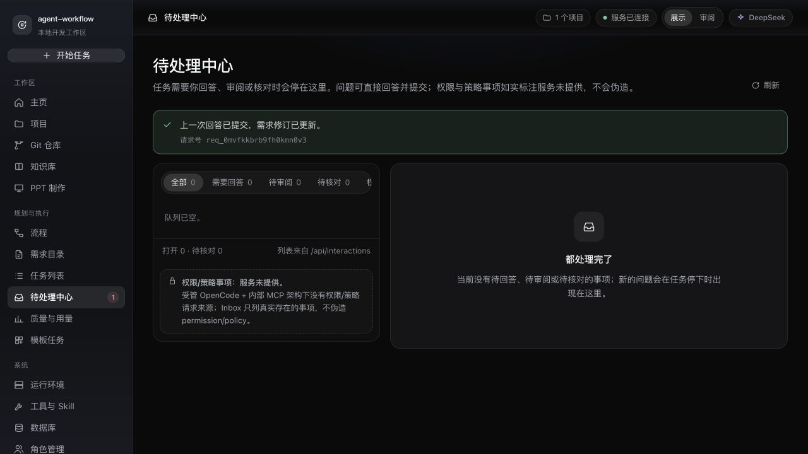

# 待处理中心：规划问题选项与答复

本批只闭环规划问题的选项模型；执行节点原生 question/permission/policy 事件仍属后续工作，不将静态禁用区记为完成。

- 模型候选与 `workflow.question.ask` 可提交稳定选项 ID、文字、说明、推荐标记、多选及其他文字开关。内部 MCP、存储、HTTP 读取与需求画布/待处理中心均保留这些字段。
- 单选互斥，多选可追加，推荐只作标记；用户明确采用后仍须单独提交。旧文本问题保持文本答复，不伪造选项。答复同时保存实际选项 ID 与服务端标签拼出的文字。
- 服务拒绝非法/重复选项、超出单选数量、禁止的其他回答；问题必须属于对应任务轮次。原 requestKey 的 succeeded/accepted/unknown 均不会再次增加需求修订。
- 离线 MCP/真实 HTTP/SQLite 回归 21/21 通过，类型检查、Web 构建通过。未宣称真实模型生成这些选项。
- CUA 使用独立 5281 真实服务与明确标为离线夹具的两道题。验证初始未自动选推荐、明确采用推荐后单选与两项多选勾选、改选单选、追加第三多选与文字、提交成功真实回执 `req_0mvfkkbrb9fh0kmn0v3`，待答队列归零。这里只证明浏览器交互，未证明原生 Electron 或全四主题状态矩阵。

