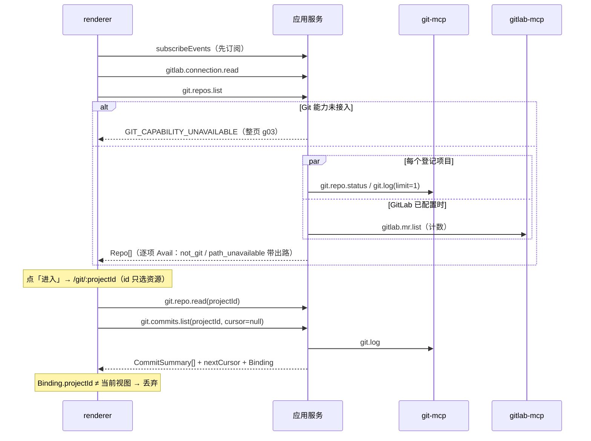
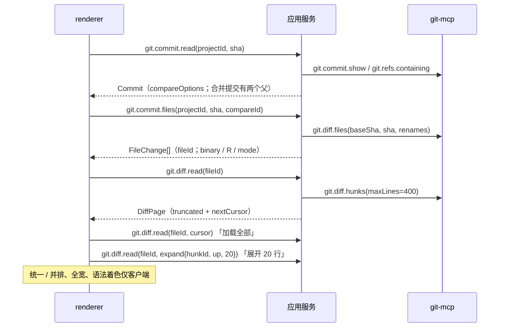
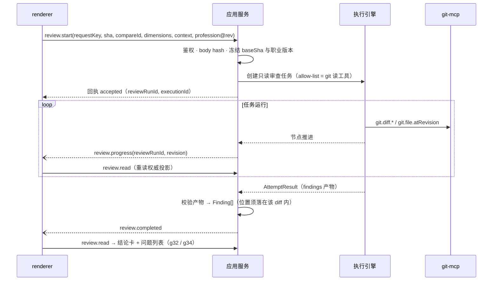
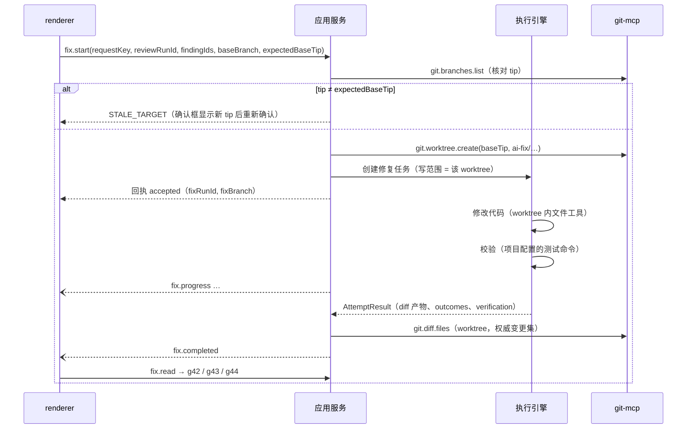
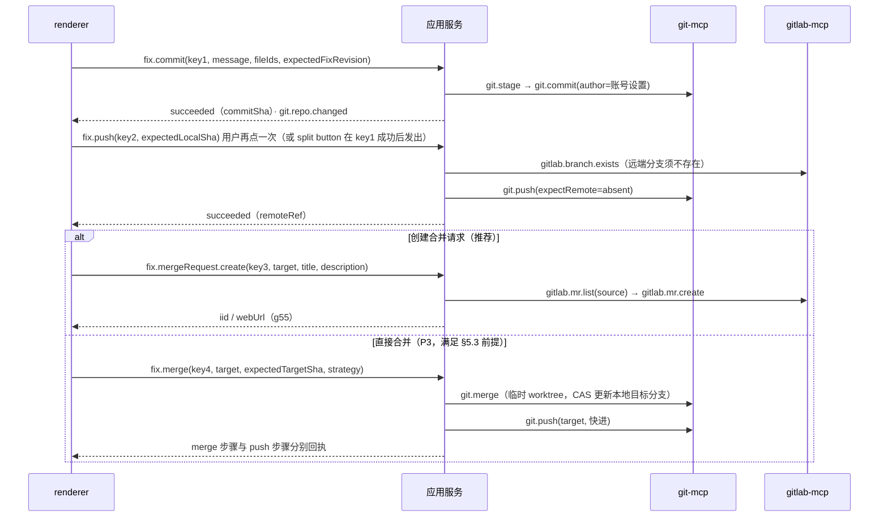
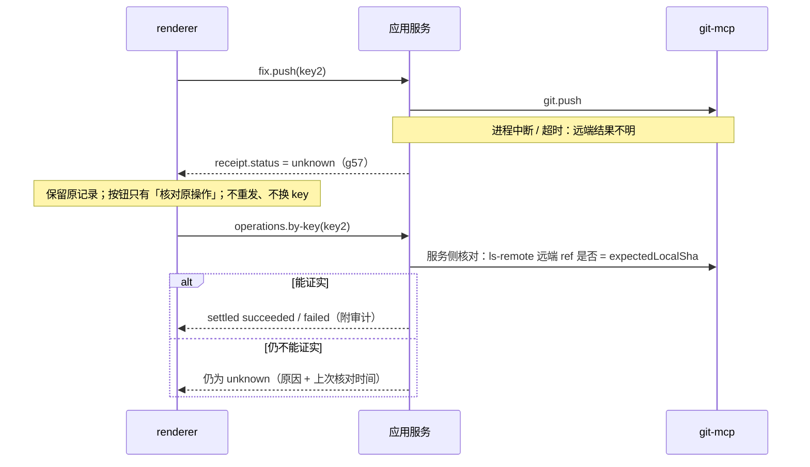
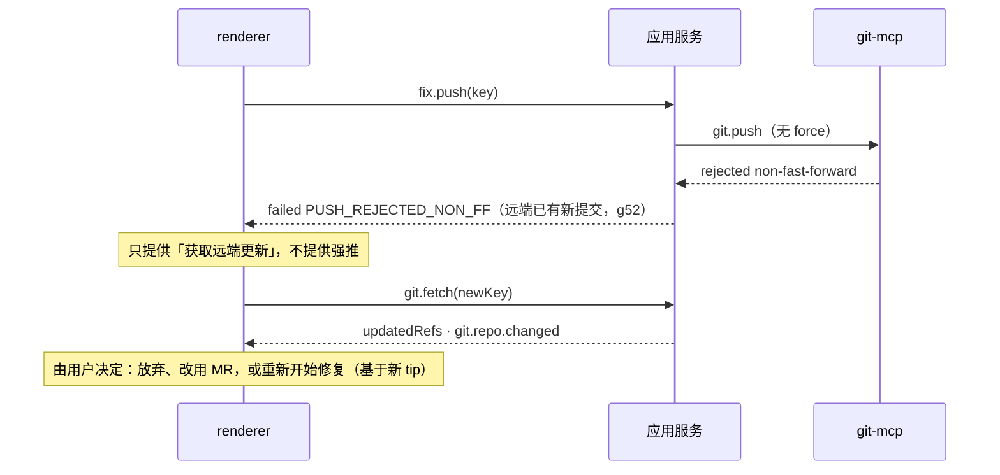

# opencode-workflow · Git 仓库页 · 同版 API 设计草案

> **版本标签：设计同版 2026-10-13 · 对应原型 prototype/index.html**
> 设计规格：`GIT-SPEC.md`（主会话定稿）。状态 id（`g01-overview` … `g58-discard-confirm`）与原型 `?state=` 参数一致。
> 写法与原则沿用 `node-detail/API-REQUIREMENTS.md`（设计同版 2026-10-12）和 `node-execution-detail-…/02-API-NEEDS.md`。

## 0. 范围、非保证声明与分层

### 0.1 范围

本文覆盖 Git 仓库页的两层：仓库概览 `/git` 和仓库工作台 `/git/:projectId`。具体包括：只读浏览（提交、提交详情、diff、分支、合并请求）；AI 审查（只读）；AI 修复（在隔离的修复分支中写入）；修复之后的提交、推送、创建合并请求、直接合并和放弃修复；以及这些流程中的异常、回执未知和事件。

不在范围内：「设置 → GitLab」页本身的写口（保存地址和令牌、验证连接），以及项目页和任务页的改动。本文只引用它们的投影。

### 0.2 非保证声明

1. 本文是给 codex / 后端 / 领域 owner 冻结用的**需求草案**，不是已批准的契约。本文不修改 `shared/contracts`。
2. **事实来源边界**：撰写者**无权访问生产源码**，没有读过 opencode-workflow 仓库、`shared/contracts`，也没有读过内部 git / gitlab MCP 的实现或 schema，没有运行过 GUI、git 或模型。来自用户的事实只有三条：(a) Git 能力正在接入，后续以**内部 MCP（git / gitlab）**提供；(b) GitLab 连接在「设置 → GitLab」中管理；(c) 项目页已经会显示项目是否受 Git 管理。
3. 本文的「现有」只指两份参考文档记载的通用机制，见 §1.1。这些机制是否适用于 Git 命令，同样待确认。
4. **所有 Git / GitLab 项一律「候选，待接入 / 冻结」**，包括 MCP 工具、应用操作、字段、事件、错误码和权限名。这些名称只用于沟通，codex / 后端可以改名、并入现有同版操作或拒绝。本文**不声称其中任何一项已存在、已安装或已验证**，文中也没有任何真实的 HTTP 端点。
5. 原型中的成功画面（审查结果、修复通过、推送成功、MR 已创建）都是 `fixtures.js` 中的虚构样例。原型不连接 git、GitLab、模型或 `window.workflowDesktop`。
6. §1.2 的 MCP 工具名**不是 renderer 可以调用的接口**。renderer 只面对 §1.3 的应用操作。

**标记约定**

| 标记 | 含义 |
| --- | --- |
| 现有 | 参考文档明文记载的通用机制，仅限 §1.1 |
| 「候选，待接入 / 冻结」 | 设计需要、尚未存在或尚未确认的名称、字段和行为。表格的「标记」列写作「候选」，含义相同 |
| 未知 | 无依据，需确认，见 §7 |
| 仅客户端 | 纯前端行为，不需要 API，例如统一 / 并排切换、全宽阅读、语法着色 |

### 0.3 分层图

```
┌──────────────────────────── renderer（Git 仓库页）─────────────────────────────┐
│ 只发送：选择 id（projectId / sha / fileId / reviewRunId / fixRunId / findingId）  │
│        + 用户可编辑字段（提交信息、MR 标题与描述）+ requestKey                    │
│ 从不发送：路径、revspec 表达式、远端 URL、令牌、scope、force 选项                  │
└──────────────┬──────────────────────────────────────────────▲─────────────────┘
               │ DesktopBridge（可信 preload / session）        │ subscribeEvents（只作提示）
┌──────────────▼──────────────────────────────────────────────┴─────────────────┐
│ 应用服务（权威）                                                                │
│  读口：git.repos.list / git.repo.read / git.commits.list / git.diff.read / …   │
│  命令（operations）：git.fetch / review.* / fix.*                               │
│     commandId = requestKey · 同版 body hash · 回执 · operations.by-key          │
│  授权 · 路径约束 · 凭据注入 · 脱敏 · 锁 · 审计 · 速率限制                       │
│  执行引擎：审查任务（只读模板）/ 修复任务（写范围 = 修复 worktree）             │
└──────────┬───────────────────────────────────────────────┬────────────────────┘
           │ 服务内部调用（服务持有身份与凭据）              │
┌──────────▼───────────┐                         ┌─────────▼────────────┐
│ git-mcp（内部）      │                         │ gitlab-mcp（内部）    │
└──────────┬───────────┘                         └─────────┬────────────┘
┌──────────▼────────────────────────────┐        ┌─────────▼────────────┐
│ 本机 git 仓库（项目登记根）             │  push  │ GitLab API            │
│ + 服务私有的修复 worktree / 合并 worktree│──────▶│ （设置 → GitLab）     │
└───────────────────────────────────────┘ fetch  └──────────────────────┘
```

push 和 fetch 由 git-mcp 通过 HTTPS 与 GitLab 远端通信，所用凭据仍由服务注入。

### 0.4 为什么 renderer 不直接调用 MCP 或 git

| 理由 | 说明 |
| --- | --- |
| 授权 | 每次读写都由服务按可信 session 鉴权。URL 中的 `projectId` / `sha` 只选资源，不授予权限。MCP 工具没有 session 的概念 |
| 凭据 | GitLab 令牌只在服务端（来自设置 → GitLab），由服务注入到 MCP 调用。renderer 接触不到令牌，就无从泄露到 DOM、日志、剪贴板或崩溃报告 |
| 回执 | 写操作需要 `commandId = requestKey`、同版 body hash、可核对的回执和 `operations.by-key`。这些只存在于服务层，MCP 工具本身不保证幂等 |
| 路径与 revision 约束 | 服务把 projectId 解析为登记根和 repoHandle，把 ref 解析为完整 SHA。renderer 传不了任意路径或 revspec |
| 脱敏 | hook 输出、git 错误文本和远端消息中可能带令牌或内部地址，必须由服务先脱敏再下发 |
| 锁与审计 | 同一仓库的写操作需要串行化，每次写操作都需要审计记录。这两件事都只能在服务一处完成 |
| AI 边界 | AI 任务的 MCP allow-list 由服务按任务模板设定，renderer 无法扩大 |

---

## 1. 能力分层

### 1.1 现有通用机制（仅按参考文档记载；是否适用于 Git 未知）

| 机制 | 记载内容 | 在本页的用法 |
| --- | --- | --- |
| operation id 风格 | `execution.read`、`node.evidence`、`node.attempts.list` | 本文候选名沿用 `域.资源.动作` 的写法 |
| 命令回执 | commandId = requestKey，同版 body hash 绑定 | 所有 §1.3.3 命令 |
| `operations.by-key` | 按原 requestKey 核对回执；读到相同值不能清除「未明」；不能跨 project 搬运 | g36、g57，以及所有写命令的 UNKNOWN |
| DesktopBridge `subscribeEvents` / `onEvent` / `unsubscribeEvents` | 业务事件触发权威快照重读；无 seq / cursor / 重播语义的记载 | §4 |
| `execution.read` / `node.evidence` / AttemptResult / ArtifactRef | 执行状态权威、当前证据、结构化结果、产物引用 | §1.4 复用执行引擎 |
| 安全原则 | URL id 只选资源；服务权威并脱敏；不接受任意路径 / scope / credential | §5 |

依赖说明：§1.4 用到的 `artifact.read`、`node.output.read` 在节点详情文档中本身也是候选。

### 1.2 (a) 内部 MCP 工具「候选，待接入 / 冻结」

**通用约定（候选）**

- **调用方**：只有应用服务，以及受 allow-list 约束的任务 agent（§1.4）。renderer 不调用。
- **`repo`**：服务登记的不透明 `repoHandle`，由服务从 projectId 解析，**不是路径**。`worktree` 同理，是 `worktreeHandle`。
- **revision 参数**：只接受完整 SHA（40 / 64 位十六进制）或服务已经解析过的完整 ref（`refs/heads/…`、`refs/remotes/…`）。拒绝 revspec 表达式（`HEAD~2`、`a..b`、`@{u}`），也拒绝以 `-` 开头的值，防止参数注入。
- **`path` 参数**：相对仓库根、经过规范化的路径。工具内再做一次 root 约束：拒绝 `..`、绝对路径和越出根目录的符号链接。
- **凭据**：本机读写不需要凭据。`git.fetch`、`git.push` 和所有 `gitlab.*` 使用服务从「设置 → GitLab」取得的令牌，由服务按调用注入（例如进程级 askpass / 内部通道，具体机制未知）。**任何工具的 input schema 中都没有令牌字段**。令牌不写入 remote URL 或 `.git/config`。
- **通用错误**：每个工具都可能返回 `GIT_CAPABILITY_UNAVAILABLE`、`REPO_PATH_UNAVAILABLE`、`NOT_A_GIT_REPO`。超时和内部错误码待定（§7）。
- **只读调用**：使用 `--no-optional-locks` 一类选项，避免 status 刷新 index 时与用户的 git 进程争锁。

**读工具**（无副作用，天然幂等）

| 工具 | 输入 | 输出 | 凭据 | 错误码 | 标记 |
| --- | --- | --- | --- | --- | --- |
| `git.repo.status` | repo | head（branch / detached / unborn + sha）、upstream（ref、ahead、behind）、lastFetchAt、工作区计数（staged / unstaged / untracked）、shallow（depth、boundary）、isEmpty、用户工作区进行中的操作（merge / rebase…） | 无 | 通用 | 候选 |
| `git.log` | repo、from（sha 或完整 ref）、excludeRef?、author?、grep?（字面量）、since? / until?、cursor?、limit（≤200） | commits[]（sha、parents、author / committer + 时间、subject）、nextCursor、shallowBoundaryReached | 无 | `REVISION_NOT_FOUND`、`SHALLOW_HISTORY`（作为标志返回，不报错） | 候选 |
| `git.commit.show` | repo、sha | 完整提交（含 body）、refs 指向、stats | 无 | `REVISION_NOT_FOUND` | 候选 |
| `git.refs.containing` | repo、sha、limit | 包含该提交的分支名[]、truncated | 无 | `REVISION_NOT_FOUND` | 候选 |
| `git.diff.files` | repo、baseSha、headSha（或 worktree），renames=true、ignoreWhitespace? | FileChange[]（status、path / oldPath、similarity、mode、binary、+/−、size 类别） | 无 | `REVISION_NOT_FOUND`、`DIFF_TOO_LARGE`（文件数超限，返回前 N 项 + truncated） | 候选 |
| `git.diff.hunks` | repo、baseSha、headSha（或 worktree）、path、contextLines、ignoreWhitespace、cursor?、maxLines | hunks[]、truncated、nextCursor | 无 | `BINARY_FILE`（标志）、`TRUNCATED`（标志） | 候选 |
| `git.branches.list` | repo、kind（local / remote / both） | name、fullRef、tipSha、upstream、相对默认分支的 ahead / behind、isCurrent、是否在其他 worktree 中检出 | 无 | 通用 | 候选 |
| `git.refs.list` | repo、kinds（tag / head） | tags[]（name、targetSha）、HEAD | 无 | 通用 | 候选 |
| `git.mergeBase` | repo、a、b | sha 或 none | 无 | `REVISION_NOT_FOUND` | 候选 |
| `git.file.atRevision` | repo、sha、path、lineRange?、maxBytes | lines[]、binary、sizeBytes、truncated | 无 | `REVISION_NOT_FOUND`、`BINARY_FILE` | 候选 |
| `git.blame`（可选） | repo、sha、path、lineRange | 每行的 commitSha、author、time | 无 | `REVISION_NOT_FOUND` | 候选（可选） |

**写工具**（输入中没有 force 字段；服务另外拒绝任何 `+refspec`）

| 工具 | 输入 | 输出 | 副作用 | 幂等 | 凭据 | 错误码 | 标记 |
| --- | --- | --- | --- | --- | --- | --- | --- |
| `git.fetch` | repo、remote（服务登记的远端名）、prune=false | updatedRefs[]（ref、oldSha、newSha）、fetchedAt | 更新 `refs/remotes/*` 和 FETCH_HEAD；不动工作区和本地分支 | 天然幂等 | 服务注入 GitLab 令牌 | `NETWORK_UNREACHABLE`、`GITLAB_AUTH_FAILED`、`OPERATION_IN_PROGRESS` | 候选 |
| `git.worktree.create` | repo、baseSha、branch（由服务生成，限 `ai-fix/` 命名空间） | worktreeHandle、branch、headSha | 新建本地分支，并在服务私有目录下新建 worktree | 同名分支已存在且指向 baseSha 时，返回现有 worktree | 无 | `REVISION_NOT_FOUND`、内部码 `REF_EXISTS`（由服务换后缀重试） | 候选 |
| `git.worktree.remove` | worktreeHandle、deleteLocalBranch（仅 `ai-fix/*`） | removed | 删除私有 worktree 目录，可选删除本地修复分支；**不删远端分支** | 已删除视为成功 | 无 | `OPERATION_IN_PROGRESS` | 候选 |
| `git.restore` | worktreeHandle、paths[]（必须在本次变更集内） | restoredPaths | 把这些文件恢复到 worktree 基点；只作用于修复 worktree | 天然幂等 | 无 | `STALE_TARGET` | 候选 |
| `git.stage` | worktreeHandle、paths[]（必须在变更集内） | stagedPaths | 改动修复 worktree 的 index | 天然幂等 | 无 | `STALE_TARGET` | 候选 |
| `git.commit` | worktreeHandle、message、author{name,email}、expectedHeadSha、hooks 策略 | commitSha、hookOutput?（已脱敏） | 新建提交，修复分支前移 | 按 expectedHeadSha 做 CAS。HEAD 已前移、其父为 expected 且 tree 和 message 一致时，返回该提交；否则返回 `STALE_TARGET` | 无 | `HOOK_REJECTED`、`FIX_NO_CHANGES`、`STALE_TARGET` | 候选 |
| `git.push` | repo、localSha、remote、remoteRef（完整 ref）、expectRemote（`absent` 或 sha） | pushedSha、remoteRef、created | 在远端创建 ref 或快进；**永不强推** | 远端已等于 localSha 时视为成功（no-op） | 服务注入 GitLab 令牌 | `PUSH_REJECTED_NON_FF`、`REMOTE_BRANCH_EXISTS`、`PROTECTED_BRANCH`、`HOOK_REJECTED`（pre-push / pre-receive）、`GITLAB_AUTH_FAILED`、`NETWORK_UNREACHABLE` | 候选 |
| `git.merge` | repo、targetBranch、expectedTargetSha、sourceSha、strategy（`ff_only` / `no_ff`）、message? | mergeSha、kind（ff / merge） | 在服务私有的临时 worktree 中合并，成功后按 CAS 更新本地目标分支；冲突时自动 abort 并清理 | 按 CAS：目标已等于期望结果时返回该结果 | 无 | `MERGE_CONFLICT`（附冲突文件列表）、`STALE_TARGET` | 候选 |

**GitLab 工具**（凭据一律是服务持有的「设置 → GitLab」令牌）

| 工具 | 输入 | 输出 | 副作用 | 幂等 | 错误码 | 标记 |
| --- | --- | --- | --- | --- | --- | --- |
| `gitlab.project.get` | projectPath（服务从 remote URL 推得） | id、pathWithNamespace、defaultBranch、webUrl、当前账号的 access level | 无 | 是 | `GITLAB_NOT_CONFIGURED`、`GITLAB_AUTH_FAILED`、`NETWORK_UNREACHABLE`、内部码 `GITLAB_PROJECT_NOT_FOUND` | 候选 |
| `gitlab.mr.list` | gitlabProjectId、state?、sourceBranch?、targetBranch?、cursor?、limit | MR 摘要[]、nextCursor | 无 | 是 | 同上 | 候选 |
| `gitlab.mr.get` | gitlabProjectId、iid | MR 详情、commits[]（sha）、pipeline 摘要、approvals 摘要、hasConflicts | 无 | 是 | 同上 | 候选 |
| `gitlab.mr.create` | gitlabProjectId、source、target、title、description、reviewerIds?、removeSourceBranch=false | iid、webUrl | 在 GitLab 创建 MR | GitLab 没有幂等键。服务以「同一 source → target 已有打开的 MR」作为核对依据 | `MR_ALREADY_EXISTS`（附已有 iid）、`PROTECTED_BRANCH`、`GITLAB_AUTH_FAILED` | 候选 |
| `gitlab.protectedBranches.list` | gitlabProjectId | name / 通配、push 与 merge 的 access level | 无 | 是 | 同读 | 候选 |
| `gitlab.branch.exists` | gitlabProjectId、branch | exists、commitSha? | 无 | 是 | 同读 | 候选 |
| `gitlab.pipelines.list`（可选） | gitlabProjectId、ref 或 sha | status、updatedAt、webUrl | 无 | 是 | 同读 | 候选（P3） |
| `gitlab.members.search`（可选） | gitlabProjectId、query | id、username、name | 无 | 是 | 同读 | 候选（指派评审人，§7） |

### 1.3 (b) 应用操作（renderer 只面对这一层）「候选，待接入 / 冻结」

#### 1.3.1 请求通则

| 规则 | 要求 |
| --- | --- |
| 选择 id | 请求只带服务签发或回显过的 id：`projectId`、`sha`（来自服务投影的完整 SHA）、`ref`（来自 `git.branches.list` 的完整 ref 名）、`fileId`、`reviewRunId`、`findingId`、`fixRunId`。不带路径、URL、令牌或 scope |
| projectId | 概览页跨项目，所以 projectId 是选择参数。授权仍以可信 session 的 actor 为准。这一点是否改为「session 切换当前项目」待确认（§7 第 1 项） |
| Binding | 每个响应和事件都回显 `projectId` 和 `repoRevision`（服务在 refs 变化时更新的不透明值）。客户端按 `viewKey = projectId + sha / runId + 本地请求序号` 丢弃晚到的响应 |
| 可用动作 | 写相关投影携带 `actions{allowed, reasonCode, reason}`，由服务计算（例如「main 是保护分支，只能通过合并请求合并」）。UI 禁用不等于授权：命令执行时服务会重新检查 |
| 能力缺失 | 整页级 `GIT_CAPABILITY_UNAVAILABLE` 显示为 unknown 虚线样式；单项能力缺失按字段返回 `Avail` |

#### 1.3.2 读口

| 操作 | 请求（仅选择） | 响应投影 | 后端来源 | 原型状态 | 标记 |
| --- | --- | --- | --- | --- | --- |
| `git.repos.list` | 无（当前 session 的全部登记项目） | `Repo[]`：gitState、当前分支、ahead / behind、lastFetchAt、未提交数、最近提交、openMrCount（GitLab 未配置时为 null）、待处理问题数。单项失败不影响整页 | 项目登记表 + `git.repo.status` + `git.log(limit=1)` + `gitlab.mr.list`（计数）+ 审查记录 | g01、g02、g03 | 候选 |
| `gitlab.connection.read` | 无 | 只返回状态：`connected / not_configured / auth_failed / unreachable`、主机显示名、账号用户名、lastVerifiedAt。**不含令牌、令牌前缀或 scope 原文** | 设置 → GitLab 的服务端记录 | g01、g02、g22 | 候选 |
| `git.repo.read` | projectId | `Repo` + `RepoStatus` + remote 显示信息（已去除凭据）+ `webUrl` + 可切换项目列表（附不可用原因） | `git.repo.status`、`gitlab.project.get` | g10、g19、g20、g21 | 候选 |
| `git.commits.list` | projectId、ref?（默认当前分支）、author?、query?（信息或 SHA 前缀，服务解析）、since? / until?、cursor?、limit | `CommitSummary[]`（parents、refs、简化图谱泳道、审查徽标）、nextCursor、`shallowBoundaryReached`、resolvedTipSha | `git.log` + `git.refs.list` + 审查记录 | g10、g15、g20、g21 | 候选 |
| `git.commit.read` | projectId、sha | `Commit`：body、author / committer、parents、containedIn、stats、compareOptions（合并提交给出两个父）、`actions.review` | `git.commit.show`、`git.refs.containing`、`git.mergeBase` | g11、g15 | 候选 |
| `git.commit.files` | projectId、sha、compareId（来自 compareOptions）、ignoreWhitespace? | `FileChange[]`（附 fileId）、truncated、审查问题标记计数 | `git.diff.files` | g11、g12、g18 | 候选 |
| `git.diff.read` | projectId、fileId、cursor?、ignoreWhitespace?、expand?{hunkId, direction, lines} | `DiffPage`：hunks、带稳定锚点的行、truncated、nextCursor；审查问题锚点 | `git.diff.hunks`；展开上下文时用 `git.file.atRevision` | g12、g13、g14、g18、g33 | 候选 |
| `git.branches.list` | projectId、kind? | `Branch[]`：isCurrent、ahead / behind、最后提交、protected（GitLab 未配置时为 null）、关联 MR | `git.branches.list` + `gitlab.protectedBranches.list` + `gitlab.mr.list` | g16、g22 | 候选 |
| `gitlab.mergeRequests.list` | projectId、state?、cursor? | `MergeRequest[]` 摘要 | `gitlab.mr.list` | g17 | 候选 |
| `gitlab.mergeRequests.read` | projectId、iid | `MergeRequest` 详情 + commits（标出本地是否存在） | `gitlab.mr.get` | g17、g55 | 候选 |
| `review.list` | projectId、sha | 该提交的 `ReviewRun` 摘要[]（第 n 次、时间、状态） | 审查记录（§1.4） | g32（历史下拉） | 候选 |
| `review.read` | projectId、reviewRunId | `ReviewRun` + `Finding[]`（按 statusRevision） | `execution.read` + `node.evidence` + findings 产物 | g31–g36 | 候选 |
| `fix.read` | projectId、fixRunId | `FixRun`：阶段、问题对照、变更文件、校验、步骤状态与回执、actions、fixRevision | 执行引擎 + `git.diff.files`（worktree） | g41–g44、g50–g58 | 候选 |

修复改动的 diff 也用 `git.commit.files` / `git.diff.read`：请求时以 `fixRunId` 代替 `sha` 作为选择，服务把它解析为修复 worktree 与基点。用户只能读，不能指定 worktree。

#### 1.3.3 命令通则（沿用现有回执规则；用于 Git 的部分为候选）

| 规则 | 要求 |
| --- | --- |
| requestKey | renderer 在用户**确认**时（点主按钮或对话框确认）生成一次，commandId = requestKey。同一意图的网络层重传使用原 key 和原 body。用户改了任何可编辑字段（提交信息、文件勾选、MR 标题），就是新意图，使用新 key |
| body hash | 服务对规范化后的 body（全部选择 id + 可编辑字段 + expected* 字段）按同版契约计算 hash。同 key 同 hash 返回原回执；同 key 不同 hash 时拒绝（沿现有规则，码待确认） |
| expected 字段 | 改变 ref 的命令都携带期望值：`expectedBaseTip`、`fixRevision`、`expectedTargetSha`。不一致时返回 `STALE_TARGET`，要求用户在新事实上重新确认，不由服务静默改用新值 |
| 回执 | `GitOperationReceipt`：`accepted → succeeded / failed / unknown`。长操作先返回 accepted，结果由事件提示，再以读口为准 |
| UNKNOWN | 保持原记录，按钮改为「核对原操作」，调用 `operations.by-key(requestKey)`。**不重发，不生成新 key**。读到远端 ref 已等于期望 SHA，也不能由 renderer 清除未明，只有服务结算的回执可以 |
| 锁 | 同一仓库的 ref 写操作（fetch、commit、push、merge、discard）在服务端按 repo 串行。持锁期间的新命令返回 `OPERATION_IN_PROGRESS`，UI 锁定相关按钮 |
| 不连锁 | 服务不把「提交 → 推送 → MR」自动串起来。split button「提交并推送」在 renderer 侧发出**两个独立命令**：提交回执 `succeeded` 之后，才用新 key 发推送；提交回执为 unknown 时，不发推送 |

#### 1.3.4 命令

| 操作 | 请求（选择 + 可编辑） | 回执结果 | 并发 / 锁 | 前置与权限 | UNKNOWN 核对 | 原型状态 | 标记 |
| --- | --- | --- | --- | --- | --- | --- | --- |
| `git.fetch` | projectId | updatedRefs、fetchedAt；随后发 `git.repo.changed` | repo 写锁；同一仓库 30s 内重复请求合并为同一次（候选） | git 可读；GitLab 已配置；权限 `git.fetch` | 天然幂等，核对后可读 repo 状态；仍以回执为准 | g10、g22 | 候选 |
| `review.start` | projectId、sha、compareId、dimensions[]、context、professionId + professionRevision | reviewRunId、executionId | 同一 (sha, compareId) 同时最多一个运行中的审查；全局并发配额待定 | 权限 `git.review`；职业版本已发布；不需要 GitLab | `operations.by-key`；回执未知时不再开新审查 | g30、g31、g36 | 候选 |
| `review.stop` | projectId、reviewRunId | stopping → stopped | 只作用于该 run | 发起人或有权者 | 沿执行引擎的取消规则：停止请求不等于已停止 | g31、g35 | 候选 |
| `review.finding.update` | projectId、findingId、status（accepted / dismissed / false_positive / open）、reason?、expectedStatusRevision | 新的 statusRevision | 按 statusRevision 做乐观并发 | 权限 `git.review` | 可直接重读 review.read；仍沿 by-key | g32、g33 | 候选 |
| `fix.start` | projectId、reviewRunId、findingIds[]、baseBranch（完整 ref）、expectedBaseTip、professionId + revision | fixRunId、fixBranch、worktreeId、executionId | 同一 (project, baseBranch) 最多一个活动的 FixRun（未放弃且未合并），否则返回 `OPERATION_IN_PROGRESS` 并链接到已有的修复 | 权限 `git.fix`；问题均属该审查、状态不是忽略或误报；baseBranch 的 tip 等于 expected | by-key；未知时不创建第二个 worktree | g40、g41 | 候选 |
| `fix.stop` | projectId、fixRunId | stopping → stopped；worktree 保留，等待放弃 | 只作用于该 run | 发起人或有权者 | 同 review.stop | g41 | 候选 |
| `fix.file.revert` | projectId、fixRunId、fileId、expectedFixRevision | 新 fixRevision、变更文件列表 | FixRun 级锁 | 状态为 ready 且尚未提交；文件在变更集内 | 天然幂等；by-key | g42 | 候选 |
| `fix.commit` | projectId、fixRunId、message、fileIds[]、confirmVerifyFailed?（校验失败时必须为 true）、expectedFixRevision | commitSha、hookOutput? | repo 写锁 | 状态为 ready；作者取自 Git 账号设置（不在请求中）；校验失败时必须带确认 | by-key；服务可以用「修复分支 HEAD 的父 = 基点，且 tree 一致」作为结算依据 | g50、g51、g43 | 候选 |
| `fix.push` | projectId、fixRunId、expectedLocalSha | remoteRef、pushedSha、created | repo 写锁 | 已提交；GitLab 已配置；目标是修复分支自己的远端分支；**没有 force 选项** | by-key；服务用 ls-remote 结算，renderer 不自行判断 | g52、g53、g57 | 候选 |
| `fix.mergeRequest.create` | projectId、fixRunId、targetBranch、title、description、reviewerIds? | iid、webUrl | FixRun 级锁 | 已推送；目标分支存在；没有同一 source → target 的打开 MR | by-key；服务以「同 source 分支的打开 MR」结算；已存在时返回 `MR_ALREADY_EXISTS` 和已有链接 | g54、g55 | 候选 |
| `fix.merge` | projectId、fixRunId、targetBranch、expectedTargetSha、strategy | mergeSha、kind；随后推送目标分支（结果单独记步） | repo 写锁 | 见 §5.3 的直接合并前提；默认关闭（§7 第 13 项） | by-key；合并与推送分两段结算，各自可能未知 | g54、g56 | 候选（P3） |
| `fix.discard` | projectId、fixRunId | 删除 worktree 和本地修复分支；**远端分支保留** | repo 写锁 | 运行已停止或结束；推送、合并未处于进行中或未知 | 天然幂等；by-key | g58 | 候选 |

### 1.4 (c) 复用执行引擎（建议）「候选，待接入 / 冻结」

建议**不另建一套 AI 运行机制**，把审查和修复都作为执行引擎的任务运行：

| 方面 | AI 审查 | AI 修复 |
| --- | --- | --- |
| 任务形态 | 只读模板任务「代码审查」，节点为：读取改动 → 分析 → 汇总 | 模板任务「代码修复」，节点为：准备修复分支（服务步骤，非 agent）→ 修改代码 → 校验 → 完成 |
| 输入（冻结在任务开始时） | sha、compareBase（具体 baseSha）、dimensions、context、职业版本 | reviewRunId、findingIds 及其快照、baseTip、fixBranch、worktreeId、职业版本、校验命令（取自项目配置） |
| MCP allow-list | `git.commit.show`、`git.diff.files/hunks`、`git.file.atRevision`、`git.blame`、`git.log`（只读） | 修复 worktree 内的文件读写（root = 该 worktree）、`git.diff.*`（worktree）、校验命令执行器（只执行项目配置的命令）。**不包含** `git.commit/push/merge/fetch`、`gitlab.*` 写工具，也不能访问用户工作区或 `.git` 公共目录 |
| 产出（AttemptResult） | findings 产物（结构化 JSON 的 ArtifactRef）、结论摘要、维度覆盖 | 修复 diff 产物（ArtifactRef，绑定 worktree revision）、逐问题 outcome、校验记录（含日志产物） |
| 免费获得 | attempt、节点详情（正文 / 工具，若节点详情的候选已实现）、取消、回执、审计 | 同上，另有审批节点（如果策略要求在写入前审批，§7） |

Git 页从这些任务读取（Git 页不直接展示 attempt 内部细节，「在任务中查看详情」跳到任务页）：

| Git 页需要 | 读自 | 备注 |
| --- | --- | --- |
| 进度阶段 | `execution.read`：当前节点与状态 | 不显示假百分比 |
| 审查结论与问题 | `node.evidence`（汇总节点）→ findings ArtifactRef → `artifact.read`（候选） | 服务把产物投影成 `Finding[]`，renderer 不解析产物原文 |
| 修复 diff | 修复节点的 diff ArtifactRef，或 `git.diff.*`（worktree） | 两者不一致时以 worktree 的实际状态为准，并标记 |
| 校验 | 校验节点的 verification（AttemptResult.verification） | 未配置命令时为 `not_configured`，不是失败 |
| 停止 / 回执 | 执行引擎现有的取消与回执 | review.stop / fix.stop 是否直接映射到执行取消，待确认 |

**ReviewRun / FixRun 是执行之上的 Git 投影**：它们持有 executionId，并补上执行引擎没有的 Git 绑定（sha、baseSha、fixBranch、worktreeId、步骤回执）。提交、推送、合并**不是**任务节点，而是用户命令，所以 agent 无从触发。

---

## 2. 数据模型（候选 TypeScript 记法）「候选，待接入 / 冻结」

```ts
// 记法：T? 表示可缺省，缺省时 UI 显示「未知」，不编造。所有 *Id 都是服务签发的不透明字符串，客户端只比较是否相等。
// 所有 revision 都是完整 SHA；短 SHA 只用于显示，由客户端截取。
type Sha = string;            // 40 或 64 位小写十六进制
type Iso = string;
type ErrorCode = string;      // §6
type Avail<T> = { state: 'ok'; value: T } | { state: 'unavailable' | 'unknown' | 'forbidden'; code: ErrorCode; message?: string };
type Action = { allowed: boolean; reasonCode?: ErrorCode; reason?: string };
interface Binding { projectId: string; repoRevision?: string; readAt: Iso }
interface Repo {
  projectId: string; projectName: string;
  gitState: 'git' | 'not_git' | 'path_unavailable' | 'capability_unavailable';
  displayRoot?: string;                       // 仅用于显示，不是路径能力
  defaultBranch?: string;
  remote?: { name: string; displayUrl: string /* 已去凭据 */; webUrl?: string };
  gitlab: 'connected' | 'not_configured' | 'auth_failed' | 'unreachable' | 'project_not_matched';
  status?: Avail<RepoStatus>;
  summary?: { lastCommit?: CommitSummary; openMrCount: number | null; pendingFindingCount: number };
}
interface RepoStatus {
  head: { kind: 'branch'; branch: string; sha: Sha } | { kind: 'detached'; sha: Sha } | { kind: 'unborn'; branch: string };
  upstream?: { ref: string; ahead: number; behind: number };   // 相对上次获取，不是实时值
  lastFetchAt?: Iso;
  workingTree: { uncommitted: number; staged: number; untracked: number };   // 只作提示
  userOperationInProgress?: 'merge' | 'rebase' | 'cherry_pick' | 'revert' | 'bisect';
  shallow?: { depth?: number };
  isEmpty: boolean;
}
interface Person { name: string; email?: string; initials: string }
interface RefBadge { kind: 'head' | 'local' | 'remote' | 'tag'; name: string }
interface ReviewBadge { reviewRunId: string; state: 'running' | 'findings' | 'clean' | 'fixed' | 'failed' | 'unknown'; openCount?: number }
interface CommitSummary {
  sha: Sha; parents: Sha[]; subject: string;
  author: Person; authoredAt: Iso; committer: Person; committedAt: Iso;
  refs: RefBadge[];
  graph?: { lane: number; laneCount: number; joinsFrom?: number[] };   // 1–3 条泳道（谁来计算见 §7）
  review?: ReviewBadge;                                                // 没有审查时缺省
}
type CompareBase =
  | { compareId: string; kind: 'parent'; parentIndex: number; baseSha: Sha }
  | { compareId: string; kind: 'merge_base'; targetRef: string; targetSha: Sha; baseSha: Sha };
interface Commit extends CommitSummary {
  body: string;
  containedIn: { branches: string[]; truncated: boolean };
  stats: { files: number; additions: number; deletions: number };
  compareOptions: CompareBase[];         // 合并提交给出父 1 / 父 2
  actions: { review: Action };
}
interface FileChange {
  fileId: string;                        // 绑定 (baseSha, headSha 或 worktree revision, path)
  status: 'A' | 'M' | 'D' | 'R' | 'C' | 'T';
  path: string; oldPath?: string; similarity?: number;
  mode?: { old?: string; new?: string }; // '100644' → '100755'
  binary: boolean; submodule?: { oldSha?: Sha; newSha?: Sha };
  additions: number | null; deletions: number | null;    // 二进制为 null
  sizeClass: 'normal' | 'large' | 'too_large';
  findingCount?: number;
}
interface LineAnchor { anchorId: string /* `${blobSha}:${side}:${line}`，与分页、忽略空白无关 */; fileId: string; side: 'old' | 'new'; line: number }
interface DiffLine { kind: 'context' | 'add' | 'del' | 'no_newline'; oldLine?: number; newLine?: number; anchor: LineAnchor; text: string }
interface DiffHunk {
  hunkId: string; header: string; section?: string;
  oldStart: number; oldLines: number; newStart: number; newLines: number;
  lines: DiffLine[];
  collapsedBefore?: { lines: number };   // 「展开 20 行」
}
interface DiffPage {
  binding: Binding; fileId: string; baseSha: Sha; head: { sha: Sha } | { worktreeRevision: string };
  ignoreWhitespace: boolean; hunks: DiffHunk[];
  truncated?: { reason: 'LINE_LIMIT' | 'BYTE_LIMIT'; shownLines: number; totalLines?: number };
  nextCursor?: string;                   // 「加载全部」
  findingMarks?: { findingId: string; anchorId: string; severity: Severity }[];
}
interface Branch {
  name: string; fullRef: string; kind: 'local' | 'remote'; tipSha: Sha;
  isCurrent: boolean; checkedOutInUserWorktree: boolean; upstream?: string;
  vsDefault?: { ahead: number; behind: number };
  lastCommit: { subject: string; author: Person; authoredAt: Iso };
  protected: boolean | null;             // GitLab 未配置时为 null（未知）
  mergeRequest?: { iid: number; state: MrState };
}
type MrState = 'opened' | 'merged' | 'closed' | 'locked';
interface MergeRequest {
  iid: number; title: string; sourceBranch: string; targetBranch: string; state: MrState;
  hasConflicts: boolean; draft: boolean; author: Person; updatedAt: Iso; webUrl: string;
  pipeline?: { status: 'pending' | 'running' | 'success' | 'failed' | 'canceled' | 'skipped' } | null;
  approvals?: { required: number; given: number } | null;
  commits?: { sha: Sha; subject: string; presentLocally: boolean }[];   // 仅详情返回
}
type Severity = 'blocker' | 'critical' | 'major' | 'suggestion';           // 阻断 / 严重 / 一般 / 建议
type Dimension = 'correctness' | 'security' | 'performance' | 'quality' | 'style' | 'tests';
//               缺陷与逻辑     安全        性能            代码质量    规范与风格  测试覆盖
interface ReviewRun {
  binding: Binding; reviewRunId: string; ordinal: number; executionId: string;
  subject: { commitSha: Sha; base: CompareBase };          // 问题绑定在这里
  dimensions: Dimension[]; context: 'diff_only' | 'diff_and_related';
  profession: { professionId: string; revision: string; displayName: string };
  state: 'queued' | 'running' | 'stopping' | 'completed' | 'failed' | 'stopped' | 'unknown';
  stage?: 'reading_diff' | 'analyzing' | 'summarizing';
  startedAt?: Iso; endedAt?: Iso;
  result?: {
    summary: string;
    counts: { bySeverity: Record<Severity, number>; byDimension: Partial<Record<Dimension, number>> };
    coverage: { dimension: Dimension; checked: boolean }[];
    findingsArtifact: { id: string; revision: string; sha256: string };   // ArtifactRef 投影
  };
  failure?: { code: ErrorCode; message: string };
  receipt: GitOperationReceipt;
}
interface Finding {
  findingId: string; reviewRunId: string; ordinal: number;
  severity: Severity; dimension: Dimension;
  location: { path: string; revision: Sha; baseRevision: Sha; startLine: number; endLine: number; side: 'old' | 'new'; anchorId?: string } | null;
  title: string; detail: string;
  suggestion?: { format: 'unified_patch'; patch: string; appliesTo: Sha };
  status: 'open' | 'accepted' | 'dismissed' | 'false_positive';           // 待处理 / 接受 / 忽略 / 误报
  statusReason?: string; statusRevision: string; statusBy?: string; statusAt?: Iso;
  fix?: { fixRunId: string; outcome: FixOutcome['outcome'] };
}
interface FixOutcome {
  findingId: string;                                    // 只按 findingId 绑定
  outcome: 'fixed' | 'partial' | 'not_fixed';
  reason?: string;
  relocation: 'exact' | 'moved' | 'not_found';          // 问题位置从审查提交映射到 baseTip 后的结果
  touchedFileIds: string[];
}
interface StepState {
  state: 'not_started' | 'in_progress' | 'succeeded' | 'failed' | 'unknown';
  receipt?: GitOperationReceipt;
  result?: { commitSha?: Sha; remoteRef?: string; pushedSha?: Sha; mrIid?: number; mrWebUrl?: string; mergeSha?: Sha; mergeKind?: 'ff' | 'merge' };
  error?: { code: ErrorCode; message: string; output?: string /* hook / 远端输出，已脱敏 */ };
}
interface FixRun {
  binding: Binding; fixRunId: string; executionId: string; reviewRunId: string; findingIds: string[];
  base: { branch: string; tipSha: Sha; reviewedSha: Sha; commitsAfterReviewed: number };
  fixBranch: string; worktreeId: string;                // 不透明，不是路径
  profession: { professionId: string; revision: string; displayName: string };
  verifyCommand: { display: string; source: 'project_config' } | null;
  state: 'preparing' | 'editing' | 'verifying' | 'ready' | 'no_changes' | 'failed' | 'stopping' | 'stopped' | 'discarded' | 'unknown';
  outcomes: FixOutcome[];
  changes?: { files: FileChange[]; worktreeRevision: string };
  verification?: { state: 'passed' | 'failed' | 'not_configured' | 'error'; passed?: number; failed?: number; summary?: string; logArtifactId?: string };
  steps: { commit: StepState; push: StepState; mergeRequest: StepState; merge: StepState };
  commitDraft?: { message: string; author: Person /* 来自 Git 账号设置 */ };
  fixRevision: string;
  actions: Record<'stop' | 'revertFile' | 'commit' | 'push' | 'createMr' | 'merge' | 'discard', Action>;
}
interface GitOperationReceipt {
  operation: string;            // 'fix.push' 等
  requestKey: string;           // = commandId
  bodyHash: string; contractVersion: string;
  status: 'accepted' | 'succeeded' | 'failed' | 'unknown';
  target: { projectId: string; reviewRunId?: string; fixRunId?: string; ref?: string; expectedSha?: Sha };
  outcome?: StepState['result']; error?: StepState['error'];
  acceptedAt: Iso; settledAt?: Iso; auditId: string;
}
```

**绑定规则**

- Finding 绑定 `subject.commitSha + base.baseSha`。在其他 compareBase 下浏览同一提交时，问题标记不显示，并提示「审查对比的是父 1」。
- FixOutcome 只按 findingId 绑定。修复基于 `base.tipSha`；该值可能比审查提交更新，此时由 `relocation` 说明位置映射是否成立。
- 修复 diff 绑定 `worktreeRevision`。撤销文件后 fixRevision 和 worktreeRevision 都变化，旧 fileId 作废。

---

## 3. 关键流程时序（候选）

参与方：R = renderer，S = 应用服务，E = 执行引擎，GM = git-mcp，LM = gitlab-mcp。

### 3.1 打开页面 → 概览 → 进入仓库



### 3.2 提交详情与 diff 分页



### 3.3 审查：开始 → 事件 → 结果



### 3.4 修复：开始 → worktree → 修改 → 校验 → 结果



### 3.5 提交 → 推送 → 创建 MR / 直接合并



### 3.6 回执未知的恢复



### 3.7 推送被拒（non-fast-forward）



---

## 4. 事件「候选，待接入 / 冻结」

| 事件 | 触发 | 载荷（只含身份与版本，不含内容） | renderer 动作 |
| --- | --- | --- | --- |
| `review.progress` | 审查任务的节点或状态变化 | projectId、reviewRunId、executionId、stage、runRevision | 若是当前视图，重读 `review.read` |
| `review.completed` | 进入 completed / failed / stopped | 同上 + terminalState | 重读 `review.read`；刷新提交列表的徽标 |
| `fix.progress` | 修复阶段变化 | projectId、fixRunId、stage、fixRevision | 重读 `fix.read` |
| `fix.completed` | 进入 ready / no_changes / failed / stopped | 同上 + terminalState | 重读 `fix.read` 与修复 diff |
| `git.repo.changed` | fetch、commit、push、merge、discard 之后，或服务察觉 refs 变化（检测方式待确认） | projectId、repoRevision、changedRefs[]（名称） | 重读 `git.repo.read`；若当前分支在 changedRefs 中，提示「有新提交 · 刷新」，不自动跳动列表 |
| `operation.settled` | 任何 Git 命令的回执结算（含 unknown → settled） | projectId、requestKey、operation、status | 若该 key 在本地待定记录中，读 `operations.by-key` 或对应投影 |

规则：

1. **事件只是提示**：载荷不含问题、diff 或输出文本。UI 状态只来自重读的权威投影，不按事件载荷拼装。
2. **顺序**：同一资源按 `runRevision` / `fixRevision` / `repoRevision` 比较。小于已读值的事件直接丢弃，不按到达时间排序。
3. **去重**：按 (事件类型, 资源 id, revision) 去重。重复事件最多触发一次重读，连续事件做 250ms 合并（仅客户端）。
4. **重播**：参考文档中现有订阅没有 seq / cursor / 重播的记载。断线重连后，renderer 对当前视图全部重读（repo、当前提交、打开的 review / fix、本地待定回执），不假设补到了遗漏的事件。
5. **先订阅后读**：进入页面和切换项目时先订阅，再首读。首读期间缓冲的事件，revision 不大于首读值的丢弃。
6. **项目切换**：取消该项目相关的视图状态，丢弃旧项目的晚到事件（按 Binding.projectId）。

---

## 5. 安全与权限「候选，待接入 / 冻结」

### 5.1 原则

| 主题 | 要求 |
| --- | --- |
| 凭据只在服务端 | GitLab 令牌只从「设置 → GitLab」的服务端存储读取，按调用注入 git-mcp / gitlab-mcp。不下发给 renderer，不出现在 MCP input、remote URL、`.git/config`、命令行 argv、环境变量快照或任务 agent 的上下文中 |
| 脱敏 | git stderr、hook 输出、GitLab 错误体、审计和日志都由服务先脱敏：`https://user:token@`、`PRIVATE-TOKEN`、`Authorization`、`glpat-` 前缀等替换为 `[已隐藏]`。显示时用 `{"$redacted": kind}`（沿节点详情候选形态） |
| 路径约束 | 所有路径相对项目登记根，服务和 MCP 各做一次 root 约束（规范化、拒绝 `..`、拒绝越出根目录的符号链接）。fileId 由服务签发。renderer 没有任何路径参数 |
| revision 约束 | 只接受完整 SHA 或服务列出的完整 ref；拒绝 revspec 表达式和以 `-` 开头的值 |
| worktree 隔离 | 修复只发生在服务私有目录下的 worktree 和 `ai-fix/*` 分支。用户的工作区、index、当前分支、stash 一律不动；用户工作区有未提交改动时，修复不受影响 |
| 永不强推 | 工具和操作都没有 force 字段；服务拒绝 `+refspec`、`--force`、`--force-with-lease`、`--mirror`、`--delete`。远端分支只增不删（放弃修复时同样保留） |
| 保护分支 | 以 GitLab 的 protected branches 为准。未配置 GitLab 时视为「未知」，所有远端写入和直接合并都禁用 |
| 作者身份 | 提交的 author / committer 取自「设置」中的 Git 账号（例如 dev-zhang &lt;dev@example.com&gt;），请求中不接受作者字段。是否附加 `AI-Assisted` trailer 待确认 |
| hook 策略 | 用户命令（commit / push）在修复 worktree 中按仓库配置执行 hook：有超时，环境中清除凭据，输出脱敏后作为 `HOOK_REJECTED` 详情返回。AI agent 不能触发 commit，也就不触发 hook。修复 diff 若改动 `.githooks/`、`core.hooksPath` 指向的目录、CI 配置或构建脚本，提交前须显式确认（候选） |
| 校验命令 | 只执行项目配置的命令，AI 不能指定或修改。运行在修复 worktree 中，没有网络和凭据（沙箱程度待确认） |
| MCP allow-list | 按任务模板设定（§1.4）。审查只有读工具；修复只有 worktree 内的文件工具、diff 和校验执行器 |
| AI 不能推送或合并 | push、MR 创建、merge、discard 只能由用户点击触发的命令完成，且每次都有独立的 requestKey 和审计；服务拒绝来自任务 actor 的这些命令 |
| 审计 | 每个命令记录：actor、requestKey、bodyHash、operation、projectId、前后 SHA、远端 ref、结果、脱敏后的错误、关联的 reviewRunId / fixRunId |
| 速率限制 | fetch 按仓库节流；GitLab 调用遵循 GitLab 速率限制并在服务端退避；审查和修复有并发配额。超限返回 `OPERATION_IN_PROGRESS` 或专用码（待确认） |
| URL 只选资源 | `/git/:projectId`、`?sha=`、`fixRunId` 只用于选择，每次读写都重新鉴权 |

### 5.2 权限矩阵

| 动作 | 前置条件 | 用户点击 | AI agent | 服务内部 |
| --- | --- | --- | --- | --- |
| 浏览（列表、提交、diff、分支、MR） | git 可读；MR 需要 GitLab 已配置 | 可以 | 审查 / 修复任务内只读 | — |
| 获取远端更新 `git.fetch` | GitLab 已配置；无写锁 | 可以 | 不可以 | 不自动定时（待确认） |
| 开始 / 停止审查 | 职业版本已发布 | 可以 | 不可以 | — |
| 更新问题状态 | 问题属于该审查 | 可以 | 不可以 | — |
| 开始修复 | 问题已选且不是忽略 / 误报；base tip 与期望一致；该分支没有活动的修复 | 可以 | 不可以 | 创建 worktree |
| 修改修复 worktree 中的文件 | 修复任务运行中；路径在 worktree 内且不在 `.git` | 不可以（UI 只能撤销整个文件） | 可以（唯一的写权限） | — |
| 运行校验命令 | 项目已配置命令 | 不可以直接触发 | 只能运行配置的命令 | 执行与收集结果 |
| 撤销文件改动 | ready 且未提交 | 可以 | 不可以 | — |
| 提交修复 | ready；校验失败时已勾选确认；作者来自设置 | 可以 | 不可以 | — |
| 推送修复分支 | 已提交；GitLab 已配置且认证有效；远端同名分支不存在 | 可以 | 不可以 | — |
| 创建合并请求 | 已推送；没有同 source → target 的打开 MR | 可以 | 不可以 | — |
| 直接合并 | §5.3 全部前提 | 可以（另需确认对话框） | 不可以 | 合并后推送目标分支 |
| 放弃修复 | 运行已停止或结束；没有进行中或未知的推送 / 合并 | 可以 | 不可以 | 删除 worktree 与本地分支 |
| 强推 / 删除远端分支 / 改写历史 | — | 不提供 | 不可以 | 不可以 |
| 修改用户工作区或当前分支 | — | 不提供 | 不可以 | 不可以（直接合并见 §5.3） |
| 读取令牌 | — | 不可以 | 不可以 | 仅在注入时使用 |

### 5.3 直接合并前提（全部满足才允许；P3）

1. GitLab 已配置，且目标分支**不是保护分支**（protected 为 null 时按「未知」处理，禁用）。
2. 目标分支本地 tip 等于 `expectedTargetSha`，且与远端一致：先获取远端更新，不存在落后。
3. 可以快进，或三方合并无冲突（在临时 worktree 中试合并）。有冲突时返回 `MERGE_CONFLICT` 和冲突文件列表，并建议改用合并请求。
4. 目标分支**不是用户工作区当前检出的分支**。规格只禁用「当前检出且有未提交改动」的情况；本文建议即使工作区干净也禁用，因为从另一个 worktree 移动已检出的分支会让用户的 index 和工作区与 HEAD 脱节，见 §7 第 14 项。
5. 用户工作区没有进行中的 merge / rebase；修复的校验通过，或已显式确认。
6. 修复分支已提交（是否必须先推送见 §7 第 15 项）。合并后推送目标分支，同样永不强推；被拒时本地合并结果如何处理需冻结。

---

## 6. 错误码「候选，待接入 / 冻结」

| 码 | 含义 | UI 处理 | 状态 id |
| --- | --- | --- | --- |
| `GIT_CAPABILITY_UNAVAILABLE` | 内部 git MCP 未接入或不可用 | 整页 unknown 虚线样式：「Git 能力尚未接入」，说明后续以内部 MCP 提供；不是错误样式 | g03 |
| `NOT_A_GIT_REPO` | 项目是直接执行目录，不受 Git 管理 | 卡片显示原因与出路；项目切换中灰显 | g01 |
| `REPO_PATH_UNAVAILABLE` | 登记路径不存在或不可访问 | 卡片显示原因；工作台入口禁用 | g01 |
| `GITLAB_NOT_CONFIGURED` | 未在设置中配置 GitLab | 本地浏览照常；远端分支、MR、推送和合并区域显示「到 设置 → GitLab 配置连接」 | g02 |
| `GITLAB_AUTH_FAILED` | 令牌无效、过期或 scope 不足 | 远端相关区域显示失败横幅 +「去设置验证」；已加载内容保留 | g22 |
| `NETWORK_UNREACHABLE` | 远端或 GitLab 不可达 | 横幅 + 重试；保留「上次获取」时间 | g22（网络分支） |
| `DIFF_TOO_LARGE` / `TRUNCATED` | 文件数或行数超过读取上限 | 「改动过大，已显示前 400 行 · 加载全部」；有 nextCursor 才显示「加载全部」 | g18 |
| `BINARY_FILE` | 二进制文件（作为标志，不是失败） | 「二进制文件，不显示差异」，显示大小变化 | g18 |
| `REVISION_NOT_FOUND` | SHA 或 ref 不存在（被 gc、浅克隆边界、分支已删） | 详情区空态 + 返回列表；不自动跳到其他提交 | g21（变体） |
| `SHALLOW_HISTORY` | 浅克隆，历史到边界为止（作为标志） | 列表底部「只有最近 50 个提交」，不显示「加载更早」 | g20 |
| `DETACHED_HEAD` | HEAD 不在任何分支上（作为状态） | 页头 chip「当前不在任何分支上」；直接合并与修复的 base 选择要求选分支 | g20 |
| `READ_FAILED`（沿节点详情候选） | 暂时性读取失败 | 保留已加载内容 + 读取时间 +「重新读取」 | g21 |
| `REVIEW_FAILED` | 审查任务失败或产物不合规 | 失败卡 + 原因 +「在任务中查看详情」+ 重新审查（新 key） | g35 |
| `FIX_FAILED` | 修复任务失败（模型未完成、worktree 准备失败） | 失败卡 + 原因；可放弃，可查看任务 | 无专属状态（建议新增，§7） |
| `FIX_NO_CHANGES` | 修复没有改动（AI 认为无需修改） | 「AI 认为无需修改」+ 逐问题原因；只可放弃 | g44 |
| `VERIFY_FAILED` | 校验命令失败 | 失败详情；仍可提交，但必须勾选确认 | g43 |
| `HOOK_REJECTED` | pre-commit / commit-msg / pre-push / 远端 pre-receive 拒绝 | 显示脱敏后的 hook 输出；提交保持未完成，可修改信息后重试（新 key） | 无专属状态（g50 变体，§7） |
| `PUSH_REJECTED_NON_FF` | 远端有新提交 | 「先获取远端更新，再决定」，不提供强推 | g52 |
| `REMOTE_BRANCH_EXISTS` | 远端已有同名修复分支 | 说明 + 在 GitLab 打开；不覆盖；新分支名待确认 | g52 变体 |
| `PROTECTED_BRANCH` | 目标是保护分支 | 直接合并的单选卡禁用并写明原因，只能走合并请求 | g54 |
| `MERGE_CONFLICT` | 直接合并有冲突（已自动 abort） | 列出冲突文件，建议改用合并请求；本地分支未动 | g56 |
| `MR_ALREADY_EXISTS` | 同一 source → target 已有打开的 MR | 链接到已有 MR，不再创建 | g55 变体 |
| `OPERATION_IN_PROGRESS` | 仓库写锁被占用，或该分支已有活动的修复 | 相关按钮锁定，显示进行中的操作并给链接 | g41（锁定态）、g50 |
| `RECEIPT_UNKNOWN`（沿现有未明规则） | 写操作回执不明 | 保持原记录，「核对原操作」，不重发 | g36、g57 |
| `STALE_TARGET` | expected* 与当前事实不符（分支已前移、fixRevision 已变） | 重读后显示新事实，要求重新确认；不静默改用新值 | g40（变体） |
| `FORBIDDEN`（沿节点详情候选） | 当前 actor 无权 | 锁定说明；不显示相关按钮 | 无专属状态 |

---

## 7. 待确认清单（交 codex / 后端）

**接入与命名**
1. **projectId 的传递方式**：作为读写参数的选择 id，还是由 session 切换当前项目？概览页跨项目，需要哪种方式？
2. **内部 MCP 的真实工具名与 schema**：git-mcp / gitlab-mcp 的工具清单、输入输出、错误码、超时；是否已有 cursor 分页和 diff 截断；repoHandle 如何从项目登记得出。
3. **项目与仓库的对应**：一个项目是否只对应一个仓库根，有没有 monorepo 子目录或多仓库的情况；GitLab project 如何从 remote URL 匹配（主机须与设置一致？）；多个 remote 时取哪个。
4. **现有回执机制是否覆盖新命令**：commandId = requestKey、body hash、`operations.by-key` 能否直接用于 `git.*` / `review.*` / `fix.*`；同 key 不同 hash 的拒绝码是什么。

**修复工作区**
5. **是否允许 worktree**：服务私有目录放在哪里，和用户仓库共用 `.git` 是否可以接受；不允许时的替代方案（独立 clone？代价是什么）。
6. **修复分支放在哪里、如何命名**：`ai-fix/<短sha>-<MMDD>` 冲突时加后缀的规则；是否要求在服务专用的 ref 命名空间。
7. **校验命令的来源**：项目配置的哪个字段；超时；沙箱（网络、文件系统、凭据）；测试计数如何得到（解析输出还是要求结构化报告）。
8. **hook 策略**：用户命令是否执行仓库 hook；是否允许跳过；修复 diff 改动 hook 或 CI 文件时是否强制确认。
9. **修复是否需要审批节点**：写入 worktree 前，执行引擎的审批是否介入。

**GitLab**
10. **MR 模板与描述**：是否读取仓库的 `.gitlab/merge_request_templates`；AI 草拟的描述如何附审查问题列表；是否加入可识别标记以便核对。
11. **指派评审人**：是否需要 `gitlab.members.search`；可选范围是什么。
12. **GitLab 令牌 scope 与自签 CA**：浏览需要 `read_api`，推送需要 `write_repository`，创建 MR 需要 `api`；scope 不足如何呈现（`GITLAB_AUTH_FAILED` 还是独立码）。自托管实例的自签 CA 如何配置。

**合并**
13. **「直接合并」是否保留**：本文建议放到 P3 且默认关闭；若保留，在哪里执行合并（临时 worktree + CAS 更新 ref），推送被拒时本地合并结果如何回退。
14. **已检出分支**：目标分支在用户工作区中检出但工作区干净时，是否也禁用（本文建议禁用）。
15. **直接合并前是否必须推送修复分支**：stepper 的顺序是「推送 → 合并」，但直接合并在技术上不需要推送修复分支。

**模型与记录**
16. **默认职业与模型**：审查默认「代码评审员」、修复默认「软件工程师」由谁配置；版本是否冻结在开始时（规格要求冻结）。
17. **审查历史的保留**：每个提交保留几次审查；findings 产物和修复 worktree 的保留期；放弃后的修复记录是否仍可阅读。
18. **问题位置的映射**：修复基于比审查提交更新的 tip 时，问题位置如何映射（`relocation`）；映射失败时是否仍交给 AI 修复。
19. **审查徽标**：提交列表的徽标由服务聚合还是 renderer 另读；「已修复」的判定口径是什么（修复已提交？已合并？）。

**性能与其他**
20. **大仓库限制**：单次 log 上限、diff 文件数和行数上限（规格里「前 400 行」只是样例）、`refs.containing` 上限；简化图谱泳道由服务还是客户端计算。
21. **refs 变化的检测**：用户在终端操作仓库后，服务如何察觉（文件监听、轮询或不察觉），是否发 `git.repo.changed`。
22. **自动获取**：是否有后台定时 fetch；页头「上次获取」的来源是什么。
23. **速率与配额**：审查和修复的并发配额；超限码是什么。
24. **作者 trailer**：AI 修复的提交是否附加 `Co-authored-by` 或 `AI-Assisted` trailer。
25. **缺少的状态 id**：`FIX_FAILED`（模型失败）、`HOOK_REJECTED`、`REMOTE_BRANCH_EXISTS`、`MR_ALREADY_EXISTS`、`STALE_TARGET` 目前只是其他状态的变体，是否在原型中补充专属状态。

---

## 8. 分期建议

| 期 | 范围 | 应用操作 | MCP 工具 | 原型状态 | 退出标准 |
| --- | --- | --- | --- | --- | --- |
| **P0 只读浏览** | 概览、提交、详情、diff、分支、MR 列表；获取远端更新 | `git.repos.list`、`gitlab.connection.read`、`git.repo.read`、`git.commits.list`、`git.commit.read`、`git.commit.files`、`git.diff.read`、`git.branches.list`、`gitlab.mergeRequests.list/read`、`git.fetch` | git 读工具、`git.fetch`、`gitlab.project.get`、`gitlab.mr.*`（只读）、`gitlab.protectedBranches.list` | g01–g03、g10–g22 | 大仓库限制已冻结；没有任何写入用户仓库的路径（fetch 只更新 remote refs）；令牌不出服务 |
| **P1 AI 审查** | 只读审查、问题状态、diff 定位、审查历史 | `review.start/stop/read/list`、`review.finding.update` | 同 P0（审查 allow-list） | g30–g36 | 审查模板任务在执行引擎中运行；findings 产物 schema 已冻结；UNKNOWN 走 by-key |
| **P2 修复 + 提交 + 推送 + MR** | 隔离修复、校验、撤销文件、提交、推送、创建 MR、放弃 | `fix.start/stop/read`、`fix.file.revert`、`fix.commit`、`fix.push`、`fix.mergeRequest.create`、`fix.discard` | `git.worktree.*`、`git.restore`、`git.stage`、`git.commit`、`git.push`、`gitlab.branch.exists`、`gitlab.mr.create` | g40–g44、g50–g53、g55、g57、g58 | 用户工作区零改动（有测试证明）；无强推路径；每个写命令都有回执、审计和 UNKNOWN 核对 |
| **P3 直接合并、流水线** | 直接合并（若保留）、流水线状态、评审人 | `fix.merge` | `git.merge`、`gitlab.pipelines.list`、`gitlab.members.search` | g54（直接合并分支）、g56 | §5.3 前提全部可由服务判定；合并与推送的结算规则已冻结 |

**当前生产实际可支撑**：撰写者无权查看生产代码，按用户告知，只有「项目是否受 Git 管理」这一事实已在项目页显示，大致对应 g01 卡片上的 `not_git` 区分。其余画面在 codex / 后端接入并冻结对应候选能力之前，应显示「Git 能力尚未接入」（g03），不能用设计样例顶替。
